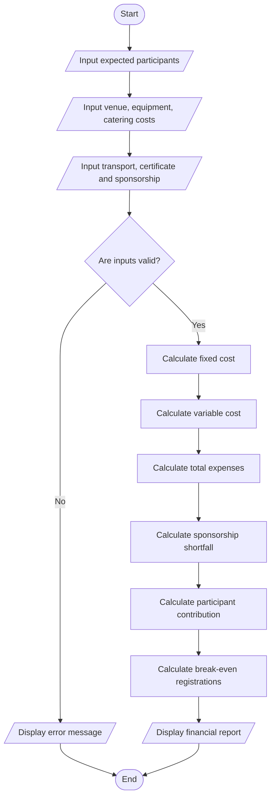

# Campus Event Financial Planning System – Python Program

## 1. Problem Statement

Develop a Python program to calculate and analyze the financial requirements of a campus event. The program calculates venue, equipment, catering, transportation, and certificate costs. It also determines total expenses, sponsorship shortfall, participant contribution, and the minimum number of registrations required to break even.

## 2. Algorithm

1. Start the program.
2. Input the expected number of participants.
3. Input venue cost.
4. Input equipment cost.
5. Input catering cost per participant.
6. Input transportation cost.
7. Input certificate cost per participant.
8. Input total sponsorship amount.
9. Calculate fixed costs.
10. Calculate variable costs.
11. Calculate total event expenses.
12. Calculate sponsorship shortfall.
13. Calculate contribution per participant.
14. Calculate minimum break-even registrations.
15. Display the financial report.
16. Stop the program.

## 3. Flowchart



## 4. Python Source Code

```

```

## 5. Sample Input

```
Enter expected number of participants: 100
Enter venue cost: Rs. 20000
Enter equipment cost: Rs. 10000
Enter catering cost per participant: Rs. 300
Enter transportation cost: Rs. 5000
Enter certificate cost per participant: Rs. 50
Enter total sponsorship amount: Rs. 25000
```

## 6. Sample Output

```
========================================
   CAMPUS EVENT FINANCIAL PLANNING
========================================

========== FINANCIAL REPORT ==========

Expected Participants : 100
Venue Cost            : Rs. 20000.00
Equipment Cost        : Rs. 10000.00
Catering Cost         : Rs. 30000.00
Transport Cost        : Rs. 5000.00
Certificate Cost      : Rs. 5000.00

-------------------------------------
Fixed Cost            : Rs. 35000.00
Variable Cost         : Rs. 35000.00
Total Expenses        : Rs. 70000.00
Sponsorship           : Rs. 25000.00
Sponsorship Shortfall : Rs. 45000.00

-------------------------------------
Contribution Per Person: Rs. 450.00
Break-even Registrations: 100

=====================================
       END OF FINANCIAL REPORT
=====================================
```

## 7. Mermaid Flowchart Code


## 8. Result

The Python program successfully calculates the financial requirements of the campus event.

For the given sample input:

- Total event expenses: ₹70,000
- Total sponsorship: ₹25,000
- Sponsorship shortfall: ₹45,000
- Participant contribution: ₹450 per person
- Minimum break-even registrations: 100 participants

Thus, the campus event requires ₹450 contribution from each participant and 100 registrations to break even.
