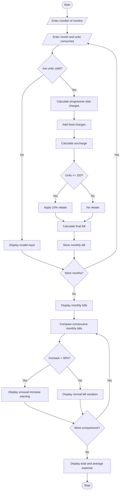

# Progressive Electricity Billing System – Python Project

## 1. Problem Statement

The Progressive Electricity Billing System is designed to calculate household electricity bills based on monthly electricity consumption using a slab-based tariff structure.

The system calculates the electricity bill by considering the following factors:

1. Electricity Consumption: Total units consumed by the household in a month.
2. Progressive Slabs: Different rates are applied to different ranges of electricity consumption.
3. Fixed Charges: A fixed amount is added to every monthly bill.
4. Surcharge: An additional percentage is charged on the electricity cost.
5. Rebate: A discount is provided based on predefined conditions.
6. Monthly Comparison: Bills from multiple months are compared to identify unusual increases in electricity expenses.

The system calculates the total bill for each month, displays the billing details, compares monthly bills, and identifies months where the bill has increased significantly compared to the previous month.

### Tariff Structure Used (Example)

| Consumption Slab | Rate per Unit |
| ---------------- | ------------- |
| 0–100 units      | ₹2            |
| 101–200 units    | ₹3            |
| 201–300 units    | ₹5            |
| Above 300 units  | ₹7            |

Additional charges:

- Fixed charge: ₹50 per month.
- Surcharge: 5% of energy charges.
- Rebate: 10% of energy charges if consumption is below or equal to 100 units.
- Unusual increase: Bill increases by more than 30% compared to the previous month.

## 2. Algorithm

Step 1: Start the program.

Step 2: Input the number of months for which electricity bills must be calculated.

Step 3: For each month, input the month name and electricity units consumed.

Step 4: Calculate the electricity charges using progressive slabs:

- First 100 units: ₹2 per unit.
- Next 100 units: ₹3 per unit.
- Next 100 units: ₹5 per unit.
- Remaining units: ₹7 per unit.

Step 5: Add fixed charges of ₹50.

Step 6: Calculate a surcharge of 5% on energy charges.

Step 7: Check whether consumption is less than or equal to 100 units.

- If yes, apply a 10% rebate on energy charges.
- Otherwise, no rebate is provided.

Step 8: Calculate the final electricity bill.

Final Bill = Energy Charges + Fixed Charges + Surcharge − Rebate.

Step 9: Store the monthly bill details.

Step 10: Compare each month's bill with the previous month's bill.

Step 11: If the bill increases by more than 30%, display an unusual increase warning.

Step 12: Display all monthly bills and the comparison results.

Step 13: Stop.

## 3. Flowchart



## 4. Python Source Code

```

```

## 5. Sample Input

```
Enter number of months: 4

Enter details for Month 1
Enter month name: January
Enter electricity units consumed: 80

Enter details for Month 2
Enter month name: February
Enter electricity units consumed: 120

Enter details for Month 3
Enter month name: March
Enter electricity units consumed: 250

Enter details for Month 4
Enter month name: April
Enter electricity units consumed: 400
```

## 6. Sample Output

```
========== ELECTRICITY BILL DETAILS ==========

Month: January
Units Consumed: 80
Energy Charges: Rs. 160.0
Fixed Charges: Rs. 50
Surcharge: Rs. 8.0
Rebate: Rs. 16.0
Total Bill: Rs. 202.0

Month: February
Units Consumed: 120
Energy Charges: Rs. 260.0
Fixed Charges: Rs. 50
Surcharge: Rs. 13.0
Rebate: Rs. 0.0
Total Bill: Rs. 323.0

Month: March
Units Consumed: 250
Energy Charges: Rs. 850.0
Fixed Charges: Rs. 50
Surcharge: Rs. 42.5
Rebate: Rs. 0.0
Total Bill: Rs. 942.5

Month: April
Units Consumed: 400
Energy Charges: Rs. 1600.0
Fixed Charges: Rs. 50
Surcharge: Rs. 80.0
Rebate: Rs. 0.0
Total Bill: Rs. 1730.0


========== MONTHLY BILL COMPARISON ==========

February vs January
Previous Bill: Rs. 202.0
Current Bill: Rs. 323.0
Change: Rs. 121.0
Increase: 59.9 %
WARNING: Unusual increase detected!

March vs February
Previous Bill: Rs. 323.0
Current Bill: Rs. 942.5
Change: Rs. 619.5
Increase: 191.8 %
WARNING: Unusual increase detected!

April vs March
Previous Bill: Rs. 942.5
Current Bill: Rs. 1730.0
Change: Rs. 787.5
Increase: 83.55 %
WARNING: Unusual increase detected!


========== BILLING SUMMARY ==========

Total Months: 4
Total Electricity Expense: Rs. 3197.5
Average Monthly Bill: Rs. 799.38

Billing Process Completed.
```

## 7. Mermaid Flowchart Code


## 8. Result

Thus, the Progressive Electricity Billing System was successfully implemented using Python.

The program calculates electricity bills using progressive consumption slabs, fixed charges, surcharges, and rebates. It also compares electricity bills across multiple months, calculates percentage increases or decreases, and identifies unusual increases in household electricity expenses.

Project completed

Note: The tariff rates and rebate conditions are assumed for academic purposes. Actual electricity tariffs vary according to the electricity distribution company and applicable government regulations.
