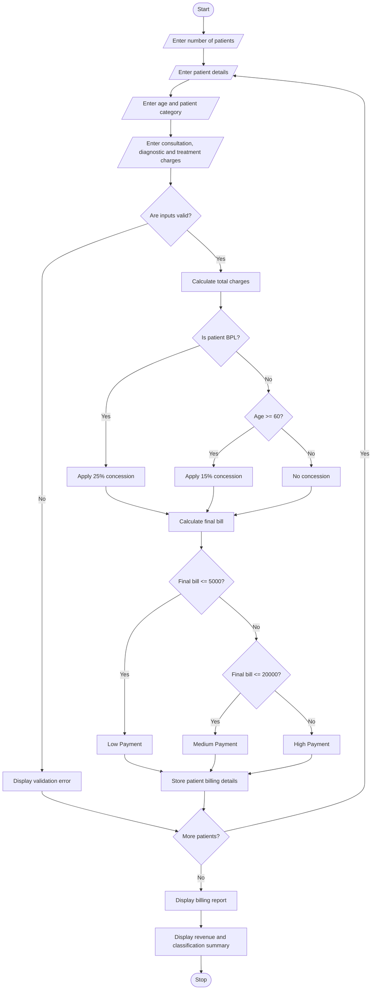

# Hospital Billing and Patient Classification System – Python Project

## 1. Problem Statement

The Hospital Billing and Patient Classification System is designed to calculate the total hospital bill based on consultation charges, diagnostic charges, and treatment charges.

The system processes patient details, calculates the total medical expenses, applies conditional concessions, validates billing constraints, and classifies patients according to a predefined payment policy.

The system considers the following criteria:

1. Consultation Charges: Fees charged by the doctor for consultation.
2. Diagnostic Charges: Expenses for laboratory tests, X-rays, scans, and other diagnostic services.
3. Treatment Charges: Expenses for medicines, procedures, and treatments.
4. Conditional Concessions: Discounts based on patient category.
5. Billing Validation: Ensures that charges and concessions are valid.
6. Patient Classification: Classifies patients according to the payment amount.

### Payment Policy Used (Example)

Concession Rules:

| Patient Category                   | Concession |
| ---------------------------------- | ---------- |
| Senior Citizen (60 years or above) | 15%        |
| Below Poverty Line (BPL)           | 25%        |
| General Patient                    | 0%         |

If a patient qualifies for multiple concessions, the system applies only the highest applicable concession.

Patient Classification Rules:

| Final Bill Amount | Patient Classification |
| ----------------- | ---------------------- |
| ₹0–₹5,000         | Low Payment            |
| ₹5,001–₹20,000    | Medium Payment         |
| Above ₹20,000     | High Payment           |

Billing Constraints:

- Charges cannot be negative.
- Patient age must be valid.
- Concession cannot exceed the total bill.
- Final bill cannot be negative.
- All required patient details must be provided.

## 2. Algorithm

Step 1: Start the program.

Step 2: Input the number of patients.

Step 3: For each patient, input:

- Patient name.
- Patient ID.
- Age.
- Patient category (BPL or General).
- Consultation charges.
- Diagnostic charges.
- Treatment charges.

Step 4: Validate the patient information and billing amounts.

Step 5: Calculate the total bill.

\\[ Total = Consultation + Diagnostic + Treatment \\]

Step 6: Check the concession eligibility.

- If the patient is BPL, apply a 25% concession.
- If the patient is 60 years or above, apply a 15% concession.
- If both conditions are satisfied, apply the higher concession of 25%.
- Otherwise, no concession is applied.

Step 7: Calculate the concession amount.

\\[ Concession = Total \times \frac{Discount\ Rate}{100} \\]

Step 8: Calculate the final bill.

\\[ Final\ Bill = Total - Concession \\]

Step 9: Classify the patient based on the final bill amount.

- Below or equal to ₹5,000: Low Payment.
- Above ₹5,000 and below or equal to ₹20,000: Medium Payment.
- Above ₹20,000: High Payment.

Step 10: Display the patient's billing details and classification.

Step 11: Repeat the process for all patients.

Step 12: Stop the program.

## 3. Flowchart



## 4. Python Source Code

```

```

## 5. Sample Input

```
Enter number of patients: 4

Enter details of Patient 1
Enter Patient ID: P101
Enter Patient Name: Arun
Enter Age: 35
Enter Category (BPL/General): GENERAL
Enter Consultation Charges: 500
Enter Diagnostic Charges: 1500
Enter Treatment Charges: 2000

Enter details of Patient 2
Enter Patient ID: P102
Enter Patient Name: Ravi
Enter Age: 65
Enter Category (BPL/General): GENERAL
Enter Consultation Charges: 1000
Enter Diagnostic Charges: 3000
Enter Treatment Charges: 6000

Enter details of Patient 3
Enter Patient ID: P103
Enter Patient Name: Priya
Enter Age: 28
Enter Category (BPL/General): BPL
Enter Consultation Charges: 500
Enter Diagnostic Charges: 2000
Enter Treatment Charges: 5000

Enter details of Patient 4
Enter Patient ID: P104
Enter Patient Name: Kiran
Enter Age: 45
Enter Category (BPL/General): GENERAL
Enter Consultation Charges: 2000
Enter Diagnostic Charges: 5000
Enter Treatment Charges: 25000
```

## 6. Sample Output

```
========== HOSPITAL BILLING REPORT ==========

Patient ID: P101
Patient Name: Arun
Age: 35
Category: GENERAL
Total Charges: Rs. 4000.0
Concession: Rs. 0.0
Final Bill: Rs. 4000.0
Patient Classification: Low Payment
-----------------------------------

Patient ID: P102
Patient Name: Ravi
Age: 65
Category: GENERAL
Total Charges: Rs. 10000.0
Concession: Rs. 1500.0
Final Bill: Rs. 8500.0
Patient Classification: Medium Payment
-----------------------------------

Patient ID: P103
Patient Name: Priya
Age: 28
Category: BPL
Total Charges: Rs. 7500.0
Concession: Rs. 1875.0
Final Bill: Rs. 5625.0
Patient Classification: Medium Payment
-----------------------------------

Patient ID: P104
Patient Name: Kiran
Age: 45
Category: GENERAL
Total Charges: Rs. 32000.0
Concession: Rs. 0.0
Final Bill: Rs. 32000.0
Patient Classification: High Payment
-----------------------------------

========== BILLING SUMMARY ==========

Total Valid Patients: 4
Total Hospital Revenue: Rs. 50125.0
Low Payment Patients: 1
Medium Payment Patients: 2
High Payment Patients: 1

Hospital Billing Process Completed.
```

## 7. Mermaid Flowchart Code


## 8. Result

Thus, the Hospital Billing and Patient Classification System was successfully implemented using Python.

The program calculates consultation, diagnostic, and treatment charges, applies conditional concessions based on patient eligibility, validates billing constraints, and classifies patients into low, medium, and high payment categories according to the predefined payment policy.

Project completed

Note: All charges, concession percentages, and classification limits are assumed for academic demonstration. Actual hospital billing and concession policies may differ. Patient classification here refers only to billing amount, not medical severity or treatment priority.
