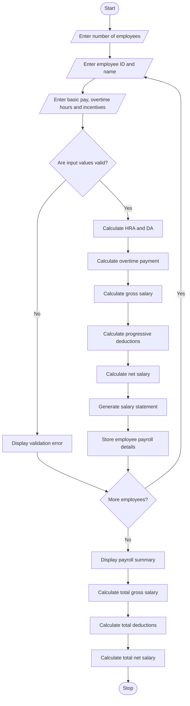

# Employee Payroll and Deduction Analysis – Python Project

## 1. Problem Statement

The Employee Payroll and Deduction Analysis System is designed to calculate employee salaries based on basic pay, allowances, overtime, and incentives.

The system calculates the gross salary, applies progressive deductions based on predefined salary slabs, determines the net salary, and generates a formatted salary statement for each employee.

The system considers the following factors:

1. Basic Pay: The fixed monthly salary of an employee.
2. Allowances: Additional payments such as House Rent Allowance (HRA) and Dearness Allowance (DA).
3. Overtime: Additional payment for extra working hours.
4. Incentives: Performance-based additional payments.
5. Progressive Deductions: Deductions calculated using different salary slabs.
6. Net Salary: Final salary after subtracting deductions from gross salary.
7. Salary Statement: Displays complete salary details for each employee.

### Salary Calculation Rules (Example)

Allowances:

- HRA = 20% of basic pay.
- DA = 10% of basic pay.
- Overtime rate = ₹200 per hour.
- Incentives = Additional amount entered by the user.

Progressive Deduction Policy:

| Gross Salary Slab | Deduction Rate |
| ----------------- | -------------- |
| First ₹10,000     | 0%             |
| Next ₹10,000      | 5%             |
| Next ₹20,000      | 10%            |
| Above ₹40,000     | 15%            |

The deduction is calculated progressively, meaning each rate applies only to the salary portion within its respective slab.

Formula:

\\[ Gross\ Salary = Basic + HRA + DA + Overtime + Incentives \\]

\\[ Net\ Salary = Gross\ Salary - Total\ Deductions \\]

## 2. Algorithm

Step 1: Start the program.

Step 2: Input the number of employees.

Step 3: For each employee, input:

- Employee ID.
- Employee name.
- Basic pay.
- Overtime hours.
- Incentives.

Step 4: Calculate HRA and DA.

Step 5: Calculate overtime payment.

\\[ Overtime = Hours \times 200 \\]

Step 6: Calculate gross salary.

\\[ Gross = Basic + HRA + DA + Overtime + Incentives \\]

Step 7: Calculate progressive deductions:

- First ₹10,000: 0%.
- Next ₹10,000: 5%.
- Next ₹20,000: 10%.
- Remaining amount: 15%.

Step 8: Add all deductions.

Step 9: Calculate net salary.

\\[ Net = Gross - Deductions \\]

Step 10: Validate salary details to ensure that negative values are not accepted.

Step 11: Generate and display the formatted salary statement.

Step 12: Repeat the process for all employees.

Step 13: Stop the program.

## 3. Flowchart

## 4. Python Source Code

```
       
```

## 5. Sample Input

```
Enter number of employees: 3

Enter details of Employee 1
Enter Employee ID: E101
Enter Employee Name: Arun
Enter Basic Pay: 20000
Enter Overtime Hours: 10
Enter Incentives: 2000

Enter details of Employee 2
Enter Employee ID: E102
Enter Employee Name: Ravi
Enter Basic Pay: 30000
Enter Overtime Hours: 15
Enter Incentives: 3000

Enter details of Employee 3
Enter Employee ID: E103
Enter Employee Name: Priya
Enter Basic Pay: 40000
Enter Overtime Hours: 20
Enter Incentives: 5000
```

## 6. Sample Output

```
========== EMPLOYEE SALARY STATEMENTS ==========

----------------------------------------
           SALARY STATEMENT
----------------------------------------
Employee ID       : E101
Employee Name     : Arun

----------------------------------------
           EARNINGS
----------------------------------------
Basic Pay         : Rs. 20000.0
HRA               : Rs. 4000.0
DA                : Rs. 2000.0
Overtime          : Rs. 2000.0
Incentives        : Rs. 2000.0

----------------------------------------
Gross Salary      : Rs. 30000.0

----------------------------------------
           DEDUCTIONS
----------------------------------------
Total Deductions  : Rs. 1500.0

----------------------------------------
NET SALARY        : Rs. 28500.0
----------------------------------------

----------------------------------------
           SALARY STATEMENT
----------------------------------------
Employee ID       : E102
Employee Name     : Ravi

----------------------------------------
           EARNINGS
----------------------------------------
Basic Pay         : Rs. 30000.0
HRA               : Rs. 6000.0
DA                : Rs. 3000.0
Overtime          : Rs. 3000.0
Incentives        : Rs. 3000.0

----------------------------------------
Gross Salary      : Rs. 45000.0

----------------------------------------
           DEDUCTIONS
----------------------------------------
Total Deductions  : Rs. 3500.0

----------------------------------------
NET SALARY        : Rs. 41500.0
----------------------------------------

----------------------------------------
           SALARY STATEMENT
----------------------------------------
Employee ID       : E103
Employee Name     : Priya

----------------------------------------
           EARNINGS
----------------------------------------
Basic Pay         : Rs. 40000.0
HRA               : Rs. 8000.0
DA                : Rs. 4000.0
Overtime          : Rs. 4000.0
Incentives        : Rs. 5000.0

----------------------------------------
Gross Salary      : Rs. 61000.0

----------------------------------------
           DEDUCTIONS
----------------------------------------
Total Deductions  : Rs. 5650.0

----------------------------------------
NET SALARY        : Rs. 55350.0
----------------------------------------

========== PAYROLL SUMMARY ==========

Total Employees: 3
Total Gross Salary: Rs. 136000.0
Total Deductions: Rs. 10650.0
Total Net Salary: Rs. 125350.0

Payroll Processing Completed.
```

## 7. Mermaid Flowchart Code


## 8. Result

Thus, the Employee Payroll and Deduction Analysis System was successfully implemented using Python.

The program calculates gross salary using basic pay, allowances, overtime, and incentives. It applies progressive deductions, calculates the final net salary, validates employee information, and generates formatted salary statements along with a payroll summary.

Project completed

Note: The salary rates, allowance percentages, overtime rate, and deduction slabs used in this program are assumed for academic purposes. Actual payroll deductions depend on applicable tax laws and company policies.
