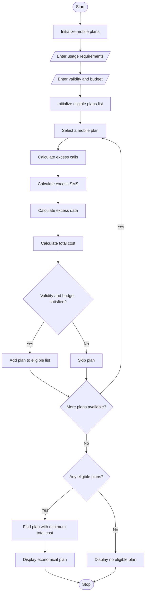

# Multi-Plan Telecommunications Cost Optimization Using Python

## 1. Problem Statement

Develop a Python program to evaluate multiple mobile telecommunications plans based on a user's monthly usage, plan validity, and budget constraints. The program should calculate the total cost of each plan, including base charges and excess usage charges for calls, SMS, and mobile data.

The program must identify plans that satisfy the user's budget, usage requirements, and validity period. Finally, it should compare all eligible plans and recommend the most economical plan based on the lowest total cost.

## 2. Algorithm

1. Start the program.
2. Initialize a list of available mobile plans.
3. Input the user's requirements:
   - Monthly calling minutes.
   - Number of SMS messages.
   - Mobile data usage in GB.
   - Required validity in days.
   - Maximum budget.
4. For each mobile plan:
   - Read the plan price.
   - Read included calling minutes.
   - Read included SMS.
   - Read included data.
   - Read plan validity.
   - Calculate excess calling charges.
   - Calculate excess SMS charges.
   - Calculate excess data charges.
   - Calculate total plan cost.
5. Check whether the plan satisfies the validity requirement.
6. Check whether the plan satisfies the budget constraint.
7. Check whether the plan satisfies the usage requirements.
8. Store eligible plans.
9. Compare the total costs of eligible plans.
10. Display the most economical eligible plan.
11. If no plan is eligible, display an appropriate message.
12. Stop the program.

## 3. Flowchart


## 4. Python Source Code

```

```

Note: All mobile plan prices, allowances, validity periods, and excess charges in this program are hypothetical values for academic demonstration, not actual telecom operator offers. The eligibility rule assumes excess usage can be charged separately, provided the total remains within budget.

## 5. Sample Input

```
MULTI-PLAN TELECOMMUNICATIONS COST OPTIMIZATION

Enter your monthly usage requirements

Calling minutes: 600
Number of SMS: 400
Data usage (GB): 7
Required validity (days): 28
Maximum budget (Rs.): 1000
```

## 6. Sample Output

```
===========================================================================
                    MOBILE PLAN COMPARISON
===========================================================================

Plan               Base Price   Extra Cost   Total Cost    Validity
---------------------------------------------------------------------------
Basic Plan             199.00       183.00       382.00          28
Standard Plan          399.00        49.00       448.00          56
Premium Plan           599.00         0.00       599.00          84
Unlimited Plan         799.00         0.00       799.00          90
===========================================================================

MOST ECONOMICAL ELIGIBLE PLAN
---------------------------------------------
Plan Name       : Basic Plan
Base Price      : Rs. 199
Excess Calls    : 400.0
Excess SMS      : 300
Excess Data     : 5.0 GB

Call Charges    : Rs. 200.0
SMS Charges     : Rs. 150.0
Data Charges    : Rs. 100.0
Total Extra Cost: Rs. 450.0
TOTAL COST      : Rs. 649.0
Validity        : 28 days

Eligible Plans: 4
```

## 7. Mermaid Flowchart Code


## 8. Result

The Multi-Plan Telecommunications Cost Optimization program was successfully implemented using Python.

The program evaluates multiple mobile plans based on calling minutes, SMS usage, data consumption, validity, and budget constraints. It calculates excess usage charges, determines the total cost of each plan, filters eligible plans, and identifies the most economical eligible mobile plan.
