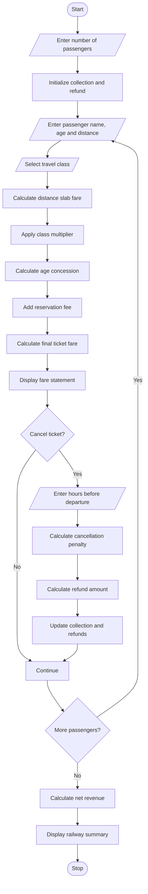

# Railway Fare and Reservation Calculator Using Python

## 1. Problem Statement

Develop a Python program to calculate railway ticket fares for multiple passengers based on travel distance, travel class, age-based concessions, and reservation fees.

The program should calculate the basic fare using predefined distance slabs, apply different fare multipliers for different travel classes, provide age-based concessions, and add reservation charges to determine the final ticket fare.

It should also calculate cancellation penalties based on the time remaining before departure, determine the refund amount, and generate individual passenger fare statements along with a final railway reservation summary.

## 2. Algorithm

1. Start the program.
2. Initialize distance-based fare slabs.
3. Define travel classes and their fare multipliers.
4. Input the number of passengers.
5. Initialize total collection and total refund.
6. For each passenger:
   - Enter passenger name and age.
   - Enter travel distance.
   - Select travel class.
   - Calculate basic fare using distance slabs.
   - Apply the travel class multiplier.
   - Calculate age-based concession.
   - Add reservation charges.
   - Calculate final ticket fare.
7. Display the passenger fare statement.
8. Ask whether the passenger wants to cancel the ticket.
9. If cancellation is selected:
   - Enter hours remaining before departure.
   - Calculate cancellation penalty.
   - Calculate refund amount.
   - Update total collection and refunds.
10. Repeat for all passengers.
11. Calculate net revenue.
12. Display the final railway summary.
13. Stop the program.

## 3. Flowchart



## 4. Python Source Code

```

```

## 5. Sample Input

```
RAILWAY FARE AND RESERVATION CALCULATOR

Enter number of passengers: 2

Passenger 1
---------------------------------------------
Passenger Name: Rahul
Passenger Age: 25
Travel Distance (KM): 250

Travel Classes:
1. Sleeper
2. AC 3 Tier
3. AC 2 Tier
4. AC First Class

Select Travel Class: 1

Cancel ticket? (yes/no): no

Passenger 2
---------------------------------------------
Passenger Name: Amit
Passenger Age: 65
Travel Distance (KM): 350

Travel Classes:
1. Sleeper
2. AC 3 Tier
3. AC 2 Tier
4. AC First Class

Select Travel Class: 2

Cancel ticket? (yes/no): yes
Hours before departure: 30
```

## 6. Sample Output

```
==================================================
          RAILWAY FARE STATEMENT
==================================================
Passenger Name : Rahul
Passenger Age  : 25
Distance       : 250.0 KM
Travel Class   : Sleeper
--------------------------------------------------
Basic Fare     : Rs. 345.00
Class Fare     : Rs. 345.00
Concession     : Rs. 0.00
Reservation Fee: Rs. 40.00
--------------------------------------------------
TOTAL FARE     : Rs. 385.00
==================================================

==================================================
          RAILWAY FARE STATEMENT
==================================================
Passenger Name : Amit
Passenger Age  : 65
Distance       : 350.0 KM
Travel Class   : AC 3 Tier
--------------------------------------------------
Basic Fare     : Rs. 475.00
Class Fare     : Rs. 950.00
Concession     : Rs. 380.00
Reservation Fee: Rs. 40.00
--------------------------------------------------
TOTAL FARE     : Rs. 610.00
==================================================

CANCELLATION STATEMENT
----------------------------------------
Ticket Fare : Rs. 610.00
Penalty     : Rs. 152.50
Refund      : Rs. 457.50

==================================================
             RAILWAY SUMMARY
==================================================
Total Passengers : 2
Total Refunds    : Rs. 457.50
Net Revenue      : Rs. 385.00
==================================================
```

## 7. Mermaid Flowchart Code


## 8. Result

The Railway Fare and Reservation Calculator was successfully implemented using Python.

The program calculates railway fares for multiple passengers using distance-based fare slabs, travel class multipliers, age-based concessions, and reservation fees. It also calculates cancellation penalties and refund amounts and generates individual passenger fare statements along with a consolidated railway summary.

Note: All fare rates, concessions, reservation fees, and cancellation percentages are hypothetical values for academic purposes. They do not represent official Indian Railways rules.
