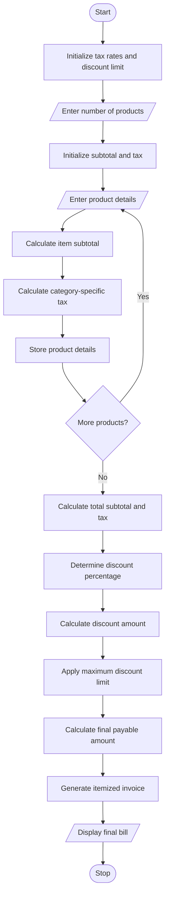

# Retail Billing with Multiple Discount Rules Using Python

## 1. Problem Statement

Develop a Python program to generate retail bills for multiple products based on product names, categories, quantities, and unit prices. The program should calculate product subtotals, apply category-specific taxes, and provide discounts based on purchase thresholds.

The program must also enforce a maximum discount limit and generate an itemized invoice showing product details, taxes, discount amounts, and the final payable amount.

## 2. Algorithm

1. Start the program.
2. Initialize category-specific tax rates and the maximum discount limit.
3. Input the number of products.
4. For each product:
   - Enter product name, category, quantity, and unit price.
   - Validate the entered details.
   - Calculate the product subtotal.
   - Calculate the category-specific tax.
   - Store the product details.
5. Calculate the total subtotal and total tax.
6. Determine the discount percentage based on the total subtotal.
7. Calculate the discount amount.
8. Apply the maximum discount limit.
9. Calculate the final payable amount.
10. Display the itemized invoice.
11. Stop the program.

## 3. Flowchart


## 4. Python Source Code

```
       
```

## 5. Sample Input

```
Enter number of products: 4

Product Name: Laptop
Category: Electronics
Quantity: 1
Unit Price: 40000

Product Name: Shirt
Category: Clothing
Quantity: 2
Unit Price: 1000

Product Name: Rice
Category: Grocery
Quantity: 2
Unit Price: 500

Product Name: Table
Category: Furniture
Quantity: 1
Unit Price: 5000
```

## 6. Sample Output

```
=====================================================================================
                         RETAIL INVOICE
=====================================================================================
Product           Category          Qty       Price     Subtotal       Tax
-------------------------------------------------------------------------------------
Laptop            electronics         1    40000.00     40000.00   7200.00
Shirt             clothing            2     1000.00      2000.00    100.00
Rice              grocery             2      500.00      1000.00      0.00
Table             furniture           1     5000.00      5000.00    600.00
-------------------------------------------------------------------------------------
Total Subtotal       : Rs. 48000.00
Total Category Tax   : Rs. 7900.00
Discount Rate        : 15%
Discount Amount      : Rs. 2000.00
Maximum Discount     : Rs. 2000.00
-------------------------------------------------------------------------------------
FINAL PAYABLE AMOUNT : Rs. 53900.00
=====================================================================================
```

## 7. Mermaid Flowchart Code


## 8. Result

The Python program successfully generates an itemized retail invoice by processing multiple products, calculating category-specific taxes, applying threshold-based discounts, and enforcing a maximum discount limit.
