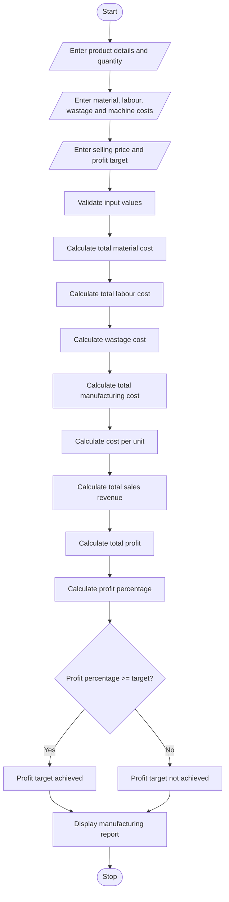

# Manufacturing Cost and Profitability Analysis Using Python

## 1. Problem Statement

Develop a Python program to calculate the total manufacturing cost and profitability of a product by considering material costs, labour charges, wastage costs, and machine operating costs.

The program should calculate the total production cost, cost per unit, selling price, total revenue, and profit. It should also compare the actual profit percentage with a specified profit target and determine whether the production meets the target.

## 2. Algorithm

1. Start the program.
2. Input the product name and production quantity.
3. Input material cost per unit.
4. Input labour charges per unit.
5. Input wastage percentage.
6. Input machine operating cost.
7. Input selling price per unit.
8. Input the required profit target percentage.
9. Calculate total material cost.
10. Calculate total labour cost.
11. Calculate wastage cost.
12. Calculate total manufacturing cost.
13. Calculate manufacturing cost per unit.
14. Calculate total sales revenue.
15. Calculate total profit and profit percentage.
16. Compare actual profit percentage with the target percentage.
17. Display the manufacturing cost and profitability report.
18. Stop the program.

## 3. Flowchart



## 4. Python Source Code

```

```

## 5. Sample Input

```
Enter product name: Wooden Chair
Enter production quantity: 100
Enter material cost per unit: 500
Enter labour charges per unit: 150
Enter wastage percentage: 5
Enter total machine operating cost: 5000
Enter selling price per unit: 850
Enter required profit target percentage: 15
```

## 6. Sample Output

```
=======================================================
          MANUFACTURING COST REPORT
=======================================================
Product Name             : Wooden Chair
Production Quantity      : 100
-------------------------------------------------------
Total Material Cost      : Rs. 50000.00
Total Labour Cost        : Rs. 15000.00
Wastage Cost             : Rs. 2500.00
Machine Operating Cost   : Rs. 5000.00
-------------------------------------------------------
Total Manufacturing Cost : Rs. 72500.00
Manufacturing Cost/Unit  : Rs. 725.00
Selling Price/Unit       : Rs. 850.00
Total Sales Revenue      : Rs. 85000.00
Total Profit             : Rs. 12500.00
Profit Percentage        : 17.24%
Required Profit Target   : 15.00%
-------------------------------------------------------
Profitability Status    : PROFIT TARGET ACHIEVED
=======================================================
```

## 7. Mermaid Flowchart Code


## 8. Result

The Python program successfully calculates the total manufacturing cost, cost per unit, sales revenue, and profit. It compares the actual profit percentage with the required target and displays whether the production meets the specified profitability target.
