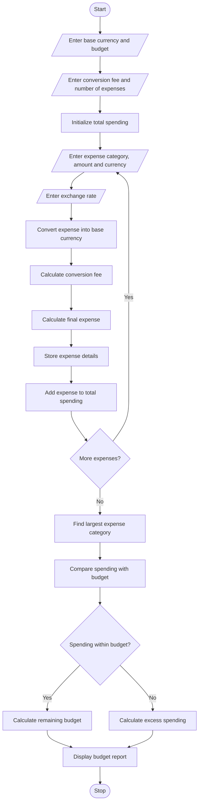

# Multi-Currency Travel Budget Analysis Using Python

## 1. Problem Statement

Develop a Python program to analyze a travel budget involving expenses in multiple currencies. The program should accept travel expense categories, amounts, currencies, exchange rates, and conversion fees.

The program must convert all expenses into a selected base currency, calculate the total travel expenditure including conversion fees, compare the total expenditure with the planned budget, and identify the largest expense category.

## 2. Algorithm

1. Start the program.
2. Input the base currency.
3. Input the total planned travel budget in the base currency.
4. Input the currency conversion fee percentage.
5. Input the number of expense categories.
6. For each expense:
   - Enter the expense category.
   - Enter the expense amount.
   - Enter the currency.
   - Enter the exchange rate relative to the base currency.
   - Convert the expense into the base currency.
   - Calculate the conversion fee.
   - Calculate the total expense including the fee.
   - Store the expense details.
7. Calculate the total travel expenditure.
8. Compare total expenditure with the planned budget.
9. Identify the largest expense category.
10. Calculate the remaining budget or excess expenditure.
11. Display the travel budget report.
12. Stop the program.

## 3. Flowchart



## 4. Python Source Code

```

```

## 5. Sample Input

```
Enter base currency (e.g. INR): INR
Enter planned travel budget: 100000
Enter conversion fee percentage: 2
Enter number of expense categories: 4

Expense 1
Enter expense category: Hotel
Enter expense amount: 300
Enter currency code: USD
Enter exchange rate (1 USD in INR): 84

Expense 2
Enter expense category: Food
Enter expense amount: 200
Enter currency code: EUR
Enter exchange rate (1 EUR in INR): 90

Expense 3
Enter expense category: Transport
Enter expense amount: 100
Enter currency code: GBP
Enter exchange rate (1 GBP in INR): 105

Expense 4
Enter expense category: Shopping
Enter expense amount: 15000
Enter currency code: INR
Enter exchange rate (1 INR in INR): 1
```

## 6. Sample Output

```
=====================================================================================
             MULTI-CURRENCY TRAVEL BUDGET REPORT
=====================================================================================
Base Currency       : INR
Planned Budget      : 100000.00 INR
Conversion Fee Rate : 2.00%
-------------------------------------------------------------------------------------
Category          Currency      Original     Converted         Fee         Total
-------------------------------------------------------------------------------------
Hotel             USD             300.00      25200.00      504.00      25704.00
Food              EUR             200.00      18000.00      360.00      18360.00
Transport         GBP             100.00      10500.00      210.00      10710.00
Shopping          INR           15000.00      15000.00      300.00      15300.00
-------------------------------------------------------------------------------------
Total Travel Spending : 70074.00 INR
Largest Expense       : Hotel
Largest Expense Amount: 25704.00 INR
Remaining Budget      : 29926.00 INR
Budget Status         : WITHIN BUDGET
=====================================================================================
```

## 7. Mermaid Flowchart Code


## 8. Result

The Python program successfully converts travel expenses from multiple currencies into a selected base currency, includes conversion fees, calculates total spending, compares expenditure with the planned budget, and identifies the largest expense category.

Note: The exchange rates in the sample input are illustrative values. Enter the exchange rates supplied in your assignment or by your chosen exchange-rate source.
