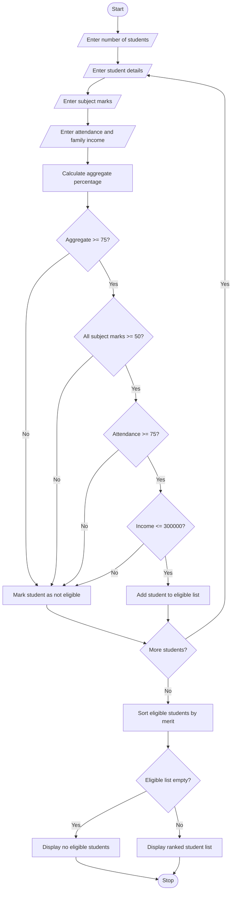

# University Scholarship Allocation System – Python Project

## 1. Problem Statement

The University Scholarship Allocation System is designed to identify and rank eligible students for scholarships based on their academic performance and financial background.

The system evaluates each applicant using the following criteria:

1. Aggregate Marks: The student must score at least 75% overall.
2. Subject-wise Minimum Marks: The student must score at least 50 marks in every subject.
3. Attendance: The student must have at least 75% attendance.
4. Family Income: The annual family income must not exceed ₹3,00,000.

Students who satisfy all the eligibility criteria are considered eligible for the scholarship.

The eligible students are ranked according to:

- Higher aggregate percentage.
- Higher attendance percentage.
- Lower annual family income.

If all three criteria are equal, the student whose application was received earlier gets a higher rank.

The system displays the list of eligible students in descending order of merit.

## 2. Algorithm

Step 1: Start the program.

Step 2: Read the number of students.

Step 3: For each student, input:

- Student name
- Roll number
- Subject marks
- Attendance percentage
- Annual family income

Step 4: Calculate the aggregate percentage.

Step 5: Check the eligibility conditions:

- Aggregate marks ≥ 75%.
- Every subject mark ≥ 50.
- Attendance ≥ 75%.
- Annual family income ≤ ₹3,00,000.

Step 6: If all conditions are satisfied, add the student to the eligible list.

Step 7: Sort eligible students using the following priority:

1. Aggregate percentage (descending).
2. Attendance percentage (descending).
3. Family income (ascending).
4. Application order (ascending).

Step 8: Display the ranked list of eligible students.

Step 9: If no students are eligible, display an appropriate message.

Step 10: Stop.

## 3. Flowchart


## 4.python source code
```

```

## 5. Sample Input

```
Enter number of students: 4

Enter details of Student 1
Enter student name: Arun
Enter roll number: 101
Enter number of subjects: 3
Enter marks in subject 1: 90
Enter marks in subject 2: 85
Enter marks in subject 3: 80
Enter attendance percentage: 90
Enter annual family income: 200000

Enter details of Student 2
Enter student name: Ravi
Enter roll number: 102
Enter number of subjects: 3
Enter marks in subject 1: 80
Enter marks in subject 2: 75
Enter marks in subject 3: 85
Enter attendance percentage: 85
Enter annual family income: 250000

Enter details of Student 3
Enter student name: Priya
Enter roll number: 103
Enter number of subjects: 3
Enter marks in subject 1: 95
Enter marks in subject 2: 90
Enter marks in subject 3: 88
Enter attendance percentage: 95
Enter annual family income: 400000

Enter details of Student 4
Enter student name: Kiran
Enter roll number: 104
Enter number of subjects: 3
Enter marks in subject 1: 60
Enter marks in subject 2: 65
Enter marks in subject 3: 70
Enter attendance percentage: 80
Enter annual family income: 180000
```

## 6. Sample Output

```
===== SCHOLARSHIP ELIGIBILITY RESULTS =====

Eligible Students Ranked by Merit:

Rank: 1
Name: Arun
Roll Number: 101
Aggregate: 85.0 %
Attendance: 90.0 %
Family Income: Rs. 200000
--------------------------------

Rank: 2
Name: Ravi
Roll Number: 102""
Aggregate: 80.0 %
Attendance: 85.0 %
Family Income: Rs. 250000
--------------------------------

Total Students: 4
Eligible Students: 2
Not Eligible Students: 2
```

Explanation:

- Arun is eligible because he satisfies all four conditions.
- Ravi is eligible because he satisfies all four conditions.
- Priya is not eligible because her family income exceeds ₹3,00,000.
- Kiran is not eligible because his aggregate percentage is below 75%.

## 7. Mermaid Flowchart Code


## 8. Result

Thus, the University Scholarship Allocation System was successfully implemented using Python. The program evaluates students based on aggregate marks, subject-wise minimum marks, attendance, and family income. It identifies eligible students, ranks them according to predefined tie-breaking rules, and displays the final scholarship merit list.

Project completed

Important: The eligibility limits used here (75% aggregate, 50 marks per subject, 75% attendance, and ₹3 lakh income) are sample rules. They can be modified according to the university's actual scholarship policy.
